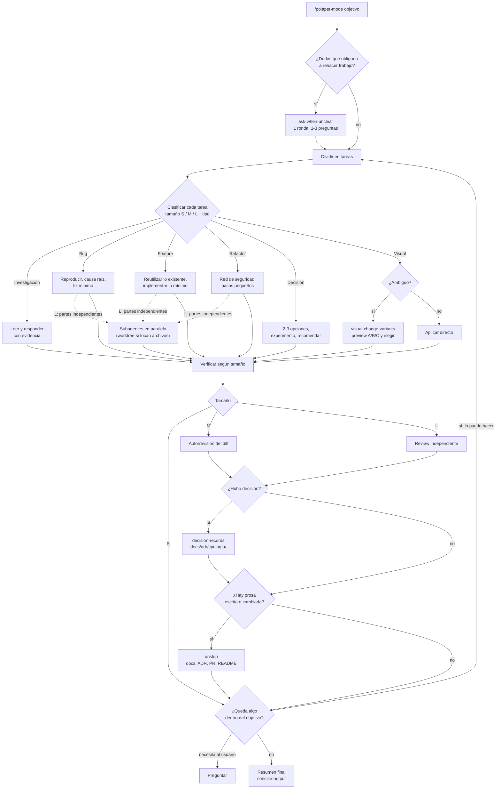
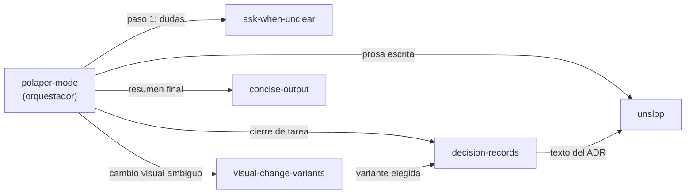

# Claude Skills

Skills para Claude (Claude Code / claude.ai) en español.

| Skill | Qué hace |
|---|---|
| [polaper-mode](polaper-mode/SKILL.md) | **Modo de trabajo** (`/polaper-mode <objetivo>`). Divide en tareas, clasifica por tamaño y tipo, delega lo paralelo, revisa solo cuando hace falta y sigue hasta terminar. Usa el resto de skills. |
| [ask-when-unclear](ask-when-unclear/SKILL.md) | Antes de implementar, detecta dudas de alcance, enfoque o criterios de aceptación y pregunta solo lo que no se pueda deducir. |
| [decision-records](decision-records/SKILL.md) | Al cerrar una tarea con una decisión técnica, la registra como ADR en `docs/adr/<tipología>/` con índice global. |
| [concise-output](concise-output/SKILL.md) | Respuestas al grano: primero el resultado, formato más claro (tabla, gráfico, lista o texto breve) y sin relleno. |
| [unslop](unslop/SKILL.md) | Quita patrones de escritura de IA y da voz humana a textos en prosa. Adaptada al español de [poteto/noodle](https://github.com/poteto/noodle) (MIT). |
| [visual-change-variants](visual-change-variants/SKILL.md) | Ante cambios visuales ambiguos, genera un preview aislado del componente con 2–4 variantes para elegir antes de tocar el código. |

## polaper-mode: flujo

El proceso escala con la tarea: una tarea S va directa; las L pasan por delegación, review y ADR.



### Estructura del repo



## Instalación

**Claude Code:** copia la carpeta de la skill a `~/.claude/skills/` (global) o a `.claude/skills/` dentro de un proyecto.

```bash
git clone https://github.com/AlPeFe/claude-skills.git
cp -r claude-skills/ask-when-unclear ~/.claude/skills/
```

**claude.ai:** comprime la carpeta de la skill en un `.zip` y súbela en *Settings → Capabilities → Skills*.

Para usar `polaper-mode` instala también las demás skills (las referencia por nombre; si faltan, tiene un resumen de cada una dentro).

```bash
cp -r claude-skills/*/ ~/.claude/skills/
```
